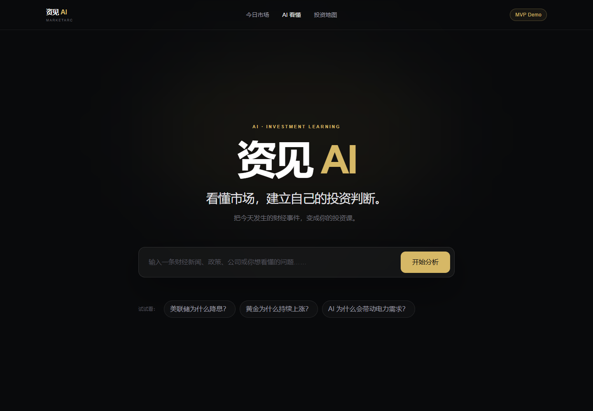
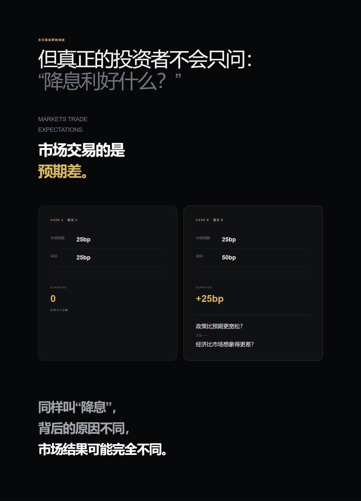
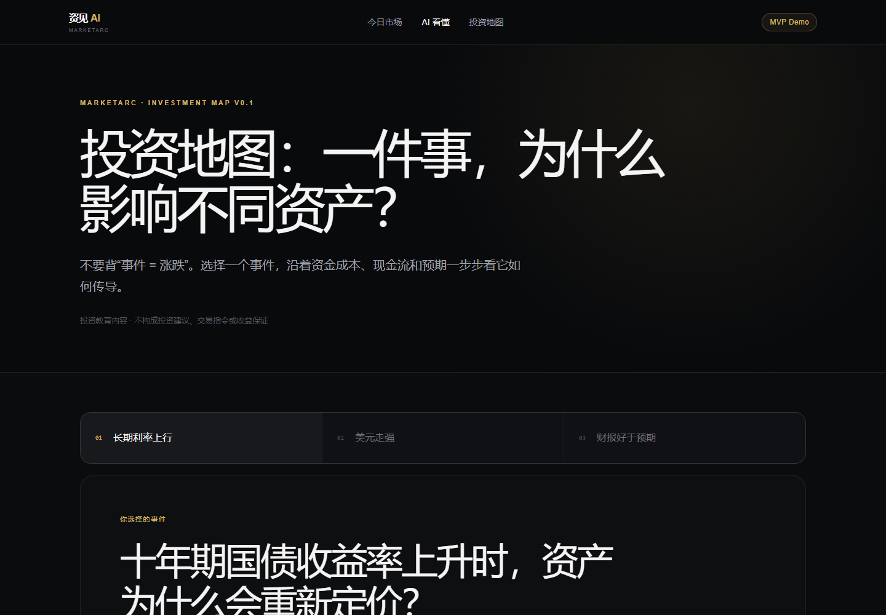
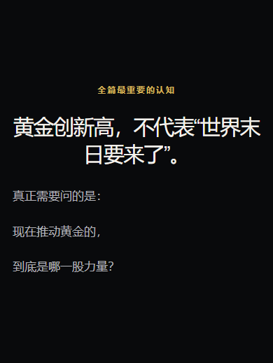

# MarketArc · 资见 AI

新手友好的 AI 投研教育平台，帮助用户把财经事件转化为可理解、可学习的投资知识。

An AI-assisted financial education prototype that explains market mechanisms, expectations, and uncertainty—not stock picks or trading signals.

**项目状态：产品验证期的个人作品。** 内置案例可无 API 试用；任意问题的真实生成仍受外部模型延迟和结构化输出稳定性影响，尚不能作为成熟投研服务使用。

## 为什么做这个产品

财经新闻告诉用户“发生了什么”，却不一定解释“为什么影响资产”和“什么条件会让判断失效”。MarketArc 把研究结果组织为连续阅读的故事：人话解释 → 因果机制 → 资产影响 → 预期差 → 反方条件 → 观察清单 → 可迁移的判断框架。

### 已实现

- 三个随代码提供的完整教育案例：降息、黄金、AI 与电力，无需密钥。
- 自定义问题的研究链路：来源检索、ResearchBrief、Story A/B、校验与合并。
- 渐进式结果：先读研究速览，再读 Story A；后续失败保留已生成内容并提供重试入口。
- 来源链接校验、FACT / INFERENCE / UNCERTAINTY 边界，以及历史快照提示。
- 响应式长文、“市场研究快照”和三条可切换的投资机制路径。
- 本地任务持久化、可选体验码、模型 JSON 检查与浏览器回归测试。

### 界面预览

截图来自内置教育案例，不代表实时行情或真实生成成功率。







<details>
<summary>查看移动端核心判断排版</summary>



</details>

## 3 分钟试用（不需要 API）

建议 Node.js 22 LTS 或更新版本。应用最低要求 20.9；包含 `--experimental-strip-types` 的本地测试需要 Node.js 22.6+。

```bash
git clone https://github.com/ciwei0374-design/marketarc.git
cd marketarc
npm ci
npm run dev -- --port 3101
```

打开 [本地首页](http://localhost:3101)，选择“美联储为什么降息？”并开始分析，再体验黄金、AI 电力案例、市场快照和投资地图。无需创建 `.env.local`；未配置模型时，自定义问题不能完成真实分析。网站需要本地服务运行，不能直接双击 HTML 或只在 GitHub 上使用。

推荐演示顺序：降息案例 → 预期差模块 → 来源与方法说明 → 投资地图 → 市场快照。内置案例的数字已标为 DEMO DATA，快照显示历史日期。

## 技术与项目贡献

Next.js App Router · React · TypeScript · Tailwind CSS · Zod · 可替换的模型/搜索适配器 · Playwright。

这是 **AI 辅助开发** 的个人产品项目：产品负责人定义用户问题、产品边界、体验反馈、质量标准与优先级；AI 协助代码实现、诊断、测试及文档。不能将仓库描述成完全手写或已有规模化用户验证的产品。

值得展示的决策包括：用条件性判断替代荐股结论；让研究事实与页面文案分层；用渐进式结果降低长等待的不确定感；未通过质量门槛的实验回退。详细背景与取舍见 [项目案例说明](docs/PORTFOLIO_CASE_STUDY.md)，内容标准见 [Product Brain](docs/marketarc/PRODUCT_BRAIN.md)。

## 当前限制与下一步

- **速度和可靠性仍未解决完。** 最近真实测试曾等待数分钟并在 Story B 遭遇 502；也出现过 JSON 校验失败。重试与部分结果不是完整成功的保证。本轮公开作品检查不调用真实 API，不把离线通过当成模型稳定性通过。
- **内容质量仍在迭代。** 主要弱点是信息密度、有效反方与术语解释；历史评估约 70 分，不宣称专业机构级研究能力。
- **持久化适合本地原型。** 使用 `data/` 下的 JSON 文件，不是 SQLite；暂无多实例共享任务队列、进程重启续跑或规模化服务保障。不适合直接部署到无持久磁盘的无服务器环境。
- **不是实时市场终端。** 市场快照为历史教育内容，内置案例为示例；无荐股、自动交易或收益保证。

下一步先验证模型的延迟与结构化输出稳定性，再做小范围内容实验；暂不扩展支付、会员等大型模块。

## 可复现检查（无真实模型调用）

```bash
npm run lint
npm run typecheck
npm run test:model-json
npm run test:link-integrity
npm run test:today-market
npm run test:investment-map
npm run test:secret-scan
npm run build
```

浏览器测试前安装 Chromium，并在独立终端从**同一目录**启动测试服务：

```bash
npx playwright install chromium
npm run start -- --port 3102
```

另一个终端执行：

```bash
npm run test:full-product
npm run test:story-ux
npm run test:responsive
```

默认连接 `http://localhost:3102`，不会启动、停止或重启其他服务。夹具只使用 Golden Story、随机 ID 和本轮拥有的临时 JSON，结束后清理；截图和报告存于被忽略的 `data/evals/`。测试覆盖桌面/手机完整流程、四场景 × 七视口排版；这是离线界面验证，不测真实模型输出质量。

已安装 Edge 的 Windows 用户可在 PowerShell 中设置 `$env:MARKETARC_BROWSER_CHANNEL="msedge"`，无需下载 Chromium；其他系统使用默认 Chromium。指定服务器时分别设置 `MARKETARC_FULL_BASE_URL`、`MARKETARC_UX_BASE_URL`、`MARKETARC_VISUAL_BASE_URL`。`npm run docs:screenshots` 更新文档截图，默认也连接 3102。

## 本地开发

环境要求：Node.js 20.9 或更高版本。

```bash
npm install
npm run dev
```

打开 <http://localhost:3000>。

要启用任意问题的 AI 分析，在项目根目录创建不会提交到 Git 的 `.env.local`：

```bash
AI_PROVIDER=openai-compatible
AI_BASE_URL=https://api.gonkarouter.io/v1
AI_API_KEY=你的服务端_API_Key
AI_MODEL=MiniMaxAI/MiniMax-M2.7
AI_RESEARCH_MODEL=
AI_STORY_MODEL=
SEARCH_PROVIDER=tavily
TAVILY_API_KEY=你的服务端_Tavily_Key
```

修改环境变量后需要重启开发服务器。API Key 只由服务端读取，不会发送到浏览器；三个内置 Golden Stories 无需任何 API 配置即可使用。`SEARCH_PROVIDER=none` 表示不执行实时网络研究，生成页面会明确披露这一点。

## How to switch AI provider

如果新服务兼容 OpenAI Chat Completions API，保持 `AI_PROVIDER=openai-compatible`，通常只需替换：

- `AI_BASE_URL`：服务商提供的兼容 API 根地址，通常以 `/v1` 结尾
- `AI_API_KEY`：服务商密钥
- `AI_MODEL`：服务商要求的模型 ID

GonkaRouter、OpenAI、DeepSeek 或其他兼容服务不会出现在业务页面和 Story Engine 中。当前适配器只使用兼容性最广的 `POST /chat/completions`，不要求服务支持 Responses API、Hosted Web Search、JSON mode 或原生 Structured Outputs。模型被要求只返回 JSON；服务端执行 `JSON.parse` 和 Zod `AnalysisStory` 校验，失败时最多进行一次 repair 请求。

如果服务不兼容 OpenAI API，只需在 `src/services/ai/providers` 新增一个实现 `AIProvider` 的 Adapter，并在 Provider Factory 注册；无需修改 `AnalysisStory`、Story Engine 或 UI。

模型调用与搜索相互独立。当前支持 `SEARCH_PROVIDER=none` 和 `SEARCH_PROVIDER=tavily`；未来搜索服务应在 `src/services/research/providers` 中新增 Adapter，输出统一 Research Context，再交给模型组织故事。

## Research Provider architecture

标准生成链路为：`User Question → Research Provider → ResearchContext → AI Provider → AnalysisStory → Story Engine`。

`ResearchContext` 是可 JSON 序列化的统一研究契约，包含原始 query、是否完成搜索、搜索时间、结构化 sources 和带来源关联的 facts。`SEARCH_PROVIDER=none` 返回 `searched: false`、空 sources 和空 facts；AI 仍可生成基础解释，但必须披露未进行实时联网研究。

未来接入搜索服务时，只需：

1. 在 `src/services/research/providers` 新增一个实现 `ResearchProvider` 的 Adapter。
2. 在 `src/services/research/provider.ts` 注册新的 `SEARCH_PROVIDER` 名称。
3. 在 `.env.local` 切换 `SEARCH_PROVIDER` 并配置该搜索服务自己的服务端环境变量。

更换 Research Provider 不影响 AI Provider、`AnalysisStory`、Story Engine 或 UI。AI Provider 接收的研究提示上下文由 Research Layer 统一从结构化 sources/facts 生成，事实优先依据 ResearchContext。

Tavily 使用直接 REST 请求，不引入额外 SDK。Research Layer 先用可扩展的机构规则生成简短 `ResearchPlan`：识别问题是否应存在原始资料、目标机构、待回答问题和市场背景查询；随后最多执行 3 个限定 `include_domains` 的 Primary Search，再执行 1 个开放 Market Context Search。结果按 URL 去重，并标记 `sourceType`、`sourceTier`、`isPrimary` 与 `primarySourceCoverage`。Tier 1 为官方、统计和公司 IR/公告，Tier 2 为高质量财经媒体，Tier 3 为专业研究，Tier 4 为其他来源；选择结果时优先保留相关 Primary Source，再补充市场背景，不以堆叠官方页面为目标。搜索超时、限流、API 错误或无结果时仍自动降级。

成功的 ResearchContext 会按 provider、证据版本与规范化问题哈希缓存在 `data/research`。市场缓存对“今天/最新/目前”等时效问题最多复用 1 小时，对其他问题最多复用 6 小时；过期后重新检索，避免旧行情被当作当前事实。同题失败后若研究缓存仍新鲜，重试不会再次调用 Tavily；切换 Search Provider 或证据版本会使用独立缓存键。研究缓存和 AnalysisStory 缓存均不提交 Git。

真实 AI 分析采用两阶段生成：`ResearchContext → Research Analyst → ResearchBrief → Story Composer → AnalysisStory`。Stage 1 只提炼紧凑、带来源 ID 的研究判断，不写页面文案；Stage 2 只读取问题和 ResearchBrief，不再读取完整搜索上下文。Story Composer 生成负责解释故事的 PartialStory A 与负责投资判断的 PartialStory B；默认串行，配置允许时可并行。两块独立校验、各自最多重试一次，再由纯代码确定性合并为完整 `AnalysisStory`，不会增加模型合并调用。`AI_RESEARCH_MODEL` 和 `AI_STORY_MODEL` 可独立切换；任一未设置时回退到 `AI_MODEL`。

Primary Source 搜索前先执行本地 Rule Planner；当它已经提供至少一个 Primary Target、Primary Query 和 Context Query 时直接使用，不额外调用模型。覆盖不足时才使用同一 AI Adapter 执行轻量 Research Planner并关闭 thinking；失败、超时或 JSON 校验失败时自动回退规则结果。Tavily 继续并行执行规划查询。

Story A/B 的生成并发由 `AI_MAX_CONCURRENCY` 控制。GonkaRouter 当前建议设为 `1`，按 Stage 1 → Story A → Story B 顺序执行；兼容更高并发的 Provider 可设为 `2` 恢复 A/B 并行。Provider 单次请求最多等待 120 秒，仅对 HTTP 429/502/503/504 再试一次，优先遵守有界 `Retry-After`，否则使用短退避与 jitter；认证错误和内容校验错误不会进入网络重试。生产日志只记录阶段、耗时、HTTP 状态与重试，不记录密钥或完整模型正文。

长分析通过本地异步 Analysis Job 执行。`POST /api/analyze` 只创建 `data/jobs/<jobId>.json` 并立即返回，浏览器跳转到 `/analysis/job/<jobId>` 后每约 1.8 秒轮询状态接口。Research、ResearchBrief、Story A、Story B 每完成一段就原子更新 Job；ResearchBrief 先渲染 QUICK TAKE，Story A 完成后先渲染故事上半篇，最终合并验证后复用完整 Story Engine。等待界面显示总耗时、当前步骤耗时和状态连接异常；若 Story B 失败，保留 Story A 前半篇并明确显示未完成与重试入口。刷新页面只重新读取 Job 文件，不会重新调用搜索或模型。Job 文件、研究缓存和生成缓存都位于项目内且不提交 Git。

ResearchBrief 缓存在 `data/briefs`，缓存键包含研究模型、Research Provider 和研究时间。Story Composer 调试或失败重试不会重新执行 Tavily 或 Research Analyst。AnalysisStory 缓存命名空间包含 Search Provider 与两个阶段模型，便于模型 A/B 测试时避免读取旧模型结果。

## GonkaRouter Provider health test

配置 `.env.local` 后运行：

```bash
npm run test:ai-provider
```

脚本会先调用 `GET /models` 确认 Base URL、认证和模型 ID，再调用 `POST /chat/completions` 并发送“请只回答：连接成功”。脚本不会打印 API Key。该命令会产生两次真实 API 请求，请只在准备好测试时运行。

可用检查命令：

```bash
npm run typecheck
npm run lint
npm run build
```

## 目录约定

- `src/app`：Next.js App Router 页面与布局
- `src/components`：可复用界面组件
- `src/lib`：底层工具与基础设施代码
- `src/services`：业务服务与外部接口封装
- `src/types`：共享 TypeScript 类型
- `data`：内置教育案例、版本化市场数据，以及本地 JSON 任务和缓存
- `public`：静态资源

运行数据位于 `data/jobs`、`data/research`、`data/briefs`、`data/generated`，不提交 Git；内置案例与版本化市场数据随源码提供。当前没有数据库依赖。

## 架构决定

### Portable Portfolio & Regression V1

公开仓库的首次体验不依赖私人任务或本机浏览器依赖路径。“市场研究快照”保留历史内容，其公开导航改为明确标注的相关 Golden Story 机制示例；不是恢复原始私有研究结果。浏览器测试使用项目依赖 Playwright、随机临时夹具及实际页面断言，缺失页面必须失败。`.worktrees` 与历史 Nightly 工作树排除在主项目类型检查之外；Turbopack 根目录显式限定为运行项目，避免嵌套检出误读父目录依赖。以下条目保留演进记录，现状以当前代码和上述限制为准。

### MarketArc Evidence and Readability Guard V1

港元、港币、HKD 与联系汇率问题先走金管局定向检索，不依赖通用媒体搜索回退；对检索结果做主题和日期筛选，并从金管局带日期的官方 URL 补全缺失的发布时间。搜索时间不等于事实时间；没有相关且带日期的证据时，ResearchBrief 不应声称已核实当前走势。缓存采用证据版本和有限时效，旧生成内容不自动复用。Story Engine 将长篇“核心判断”正文按段落排版，“预期差”英文辅助文字、中文结论和对比卡片使用独立的响应式文字层级；视觉回归覆盖长港元案例、其他真实案例、Golden Story 和部分失败状态的多个视口。

### MarketArc Local Orchestrator V1

Manager/Engineer 自动化使用官方持久 Codex CLI session 流程（`codex exec --json` 与 `codex exec resume`）。易变运行状态只保存在项目内且被 Git 忽略的 `.marketarc-orchestrator/`：AUTO MANAGER 使用 read-only，AUTO ENGINEER 使用 workspace-write 并严格受结构化 Manager Decision 限制。每次交接前检查 Human override 与 safe stop，使用原子单实例锁，持续维护 heartbeat/events，不依赖任何 UI 自动化。协议详见 `docs/marketarc/ORCHESTRATOR_PROTOCOL.md`。

- Investment Map V0.1：`/map` 使用项目内版本化 `data/market/investment-map.json` 和小型 Client Component 交互，让用户在三条事件路径间切换，并按“人话解释 → 机制链 → 资产类别影响 → 反方条件 → 上升/下降观察信号”学习条件性关系。数据契约要求每条路径至少包含三步机制、三个资产类别、两个反方条件与两个双向观察指标；资产效果只允许“可能承压 / 可能受益 / 影响分化”，不产生个股选择、交易指令或确定性预测。

- Today Market V0.1：`/today` 是基于项目内 `data/market/today-market.json` 的静态教育快照，不伪装成实时行情或新闻流；Server Component 在构建时校验快照契约，页面逐条展示 FACT、INFERENCE、UNCERTAINTY，并连接到已完成的本地深度分析。`loading.tsx`、`error.tsx` 与空数据分支提供明确的等待、失败和无可核对内容状态，不引入数据库、付费 API 或新 Provider。

- Responsive Visual Gate：关键界面改动使用隔离端口和 Playwright 在 1440×1000、390×844 两类视口审计首页、Research Progress 与完整分析；Gate 同时记录全页截图、水平溢出、关键字号和代表性交互。移动端使用作用域化 `≤560px` editorial override，桌面视觉方向不随移动修复重做。

- Rendered Link Integrity：Story Engine 只让三类目标保持可点击：已存在的应用路由、当前 Story 实际存在的 section anchor、以及显示来源域名与目标 host 匹配的 HTTP(S) URL。无真实目的地的模型 CTA 在渲染时省略，来源无可验证 URL 时保留来源说明但不伪造链接。

- Model JSON Reliability：OpenAI-Compatible Provider 的模型 JSON 在进入既有规范化与局部 repair 前，最多解开两层“整个对象被编码为 JSON 字符串”的外层包装；该兼容层只修复传输形状，不改变 Prompt、正文、PartialStory Schema 或 AnalysisStory 含义。

- MarketArc Product Brain：`docs/marketarc/PRODUCT_BRAIN.md` 是产品与内容任务的最高层长期产品认知；ChatGPT Work、Codex、Nightly Agent 与内容 Evaluator 在执行相关任务前必须先读取。若任务与其明显冲突，不自动执行，写入 Decision Queue 交由 Human / ChatGPT 决策。

- MarketArc Autonomous Development Loop V0.1：长期规则、Eval Set、质量 Rubric、Acceptance Gate、Nightly Report 与 ChatGPT Handoff 协议统一保存在 `docs/marketarc/`；真实 Eval 默认 3 题、整轮最多 5 次，并使用隔离端口避免影响公网 3001。

- Demo Access Gate：可选的 `DEMO_ACCESS_CODE` 启用统一访问保护。验证状态使用 HttpOnly Cookie 保存，页面及真实分析 API 均由服务端校验；未配置时保持本地直达体验。

- 使用 Next.js App Router、TypeScript 和 Tailwind CSS，兼顾快速迭代与长期维护。
- 使用项目内的 JSON 文件持久化任务与缓存；早期 SQLite 规划未实现。
- 使用 Tailwind CSS v4 的 PostCSS 集成，减少初期配置文件数量。
- MVP 初期通过 `/analysis?q=...` 展示案例；当前提交走 `/api/analyze` 创建持久任务，页面逐步展示结果。
- 三个内置案例来自项目内的 `data/analysis`；未匹配问题在 AI 服务配置后交由 Provider 生成，并把结果缓存到项目内。
- 页面采用深色、克制的金融科技视觉，主要交互不依赖第三方 UI 或动画库。
- “美联储为什么降息？”使用独立的 MarketArc 长篇叙事模板，以连续滚动、CSS 解释型视觉和预期差案例取代通用报告卡片；其他 Mock 暂时保留原模板。
- MarketArc 长篇分析由可序列化的 `AnalysisStory` 数据驱动；案例数据位于 `data/analysis`，`src/components/analysis-story` 根据 `visualType` 和各段结构渲染 Hero、流程、资产解释、证据、预期差、观察清单、心智模型与来源模块。
- 任意财经问题由 `/api/analyze` 调用 Provider-Agnostic AI 服务。业务层只依赖 `AIProvider` 和 `AnalysisStory`，当前唯一 Adapter 使用 OpenAI Node SDK 调用可配置的 OpenAI-Compatible Chat Completions API。
- 研究层通过 `ResearchProvider` 独立于模型层。当前 `none` Adapter 不执行实时搜索，并强制把“未进行实时网络研究”写入 disclaimer、来源和方法说明，禁止伪装联网。
- Research Source Quality 使用“Primary/Official 优先、优质媒体补充背景”的两步搜索。精确数字、政策决定、公司业绩和宏观指标必须优先绑定原始来源 ID；来源冲突由 Research Analyst 区分官方事实与市场解读，不允许跨来源补写。
- 三个内置案例继续作为不调用 API 的 Golden Stories。其他问题优先读取 `data/generated` 下按规范化问题哈希命名的 JSON 缓存，未命中才调用 Provider；生成缓存属于本地业务数据，不提交 Git。
- GonkaRouter 接入使用 OpenAI-Compatible `GET /models` 与 `POST /chat/completions` 协议；可用模型以当前帐户的 `GET /models` 返回为准。`AI_RESEARCH_MODEL` 和 `AI_STORY_MODEL` 留空时回退到 `AI_MODEL`。运行时不发送 Structured Output 或搜索工具参数；模型 JSON 最终经过统一 Zod Schema Validation，失败时仅进行一次 repair。
